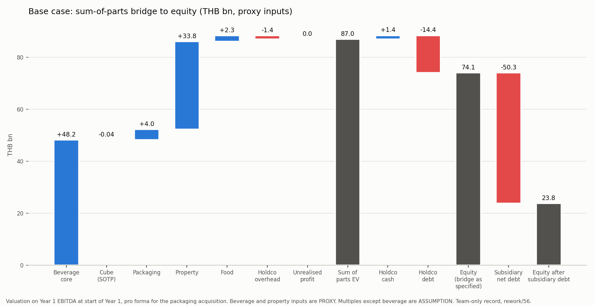

# 56. Financial projection: the lime cube inside a group (team-only)

- Status: team-only record. Nothing here goes to rework/judge/. This is arithmetic under stated proxies, not a valuation of Singha, and it is not a finding about the market. No outside contact. Nothing is sent or submitted.
- Model: [screen/financial_projection.py](screen/financial_projection.py). Results: [screen/financial_projection_results.json](screen/financial_projection_results.json). Chart: [charts/sotp_bridge_base.png](charts/sotp_bridge_base.png). Reproduce with `python rework/screen/financial_projection.py`.
- Units: million THB (MTHB) unless stated. Year 0 is the base year (proxy FY2025 values). Years 1 to 5 are projection years, not calendar years. Servings are in millions.
- Labels: SOURCED (with URL or team record), PROXY (what it stands in for), ASSUMPTION. All 105 input rows in the results JSON carry one of the three labels.

## 1. Scope from the user

- Operating subsidiaries: EBITDA, gross margin and price, working capital, capex. The non-beverage entities are controlled.
- Capital allocation: an acquisition and its ROIC.
- Holding company: overhead, financing, cash available for reinvestment.
- Consolidation: combine the controlled subsidiaries, remove intragroup transactions, derive the unrealised profit in intragroup inventory.
- Valuation: sum-of-parts by subsidiary, then holding company cash less debt, to equity value.
- Five projection years. A base case and one downside case.

## 2. Structure

```
Holding company (overhead, senior debt, cash; acquisition funding)
 |-- Beverage operating company: beer and NAB (PROXY). The cube is a new line here.
 |       ^ buys pouch film at transfer price
 |-- Packaging subsidiary: pouch film (PROXY; acquired at start of Year 1)
 |-- Property subsidiary: PROXY for Singha Estate (own net debt)
 |-- Food subsidiary: PROXY margin, ASSUMPTION scale
Consolidated EBITDA = sum of subsidiary EBITDA - change in unrealised profit in intragroup inventory
```

- Control: the group's stake in the property arm and control of the other non-beverage entities are not confirmed. The model assumes 100% control (ASSUMPTION). Minority interests are not modelled.

## 3. Inputs

### Beverage operating company (the cube sits here)

- Revenue, Year 0: THB 36,803m. PROXY for the beverage operating company, from a directory estimate of US$1.1bn at 33.46 THB/USD, with no fiscal year. https://www.infobelpro.com/companies/thailand/breweries
- Gross margin 31.4%. PROXY: ThaiBev FY2025 gross profit over revenue. https://stockanalysis.com/quote/sgx/Y92/financials/income-statement/
- EBITDA margin 14.6%. PROXY: ThaiBev beer plus NAB, nine months to 30 June 2025 (21,290 over 145,830). https://www.foodbusinessmea.com/thai-beverage-records-0-4-revenue-decline-amid-spirits-weakness/
- Growth +2% base, -2% downside. Margin cut of 1.5 pp in the downside. ASSUMPTION, anchored to ThaiBev beer and NAB revenue of -0.3% and -0.7% for nine months.
- D&A 3.1% and capex 3.9% of revenue. PROXY: ThaiBev FY2025. https://stockanalysis.com/quote/sgx/Y92/financials/cash-flow-statement/
- Receivables 19.5 days of revenue; payables 21.3 days of COGS. PROXY: ThaiBev FY2025 balance sheet. https://stockanalysis.com/quote/sgx/Y92/financials/balance-sheet/
- Inventory 40 days of COGS. ASSUMPTION. ThaiBev's group figure of about 104 days reflects spirits ageing, so it is not used.
- Net debt 3.6x EBITDA. PROXY: (total debt 234,545, less leases 7,012, less cash 43,845) over FY2025 EBITDA 50,654. Cross-check: MarketScreener net debt about 183.5bn. https://ca.marketscreener.com/quote/stock/THAI-BEVERAGE-6498120/finances/
- EV/EBITDA 8.8x. SOURCED (vendor figure for ThaiBev, FY2025), applied to the beverage company as a PROXY multiple. https://ca.marketscreener.com/quote/stock/THAI-BEVERAGE-6498120/valuation/

### Packaging subsidiary (pouch film; acquired at start of Year 1)

- External revenue THB 4,000m. ASSUMPTION (no sourced scale). Growth +3% base, 0% downside (ASSUMPTION).
- Gross margin 17.9%. EBITDA margin 14.0%, derived as operating income plus D&A. D&A 7.2% and capex 4.0% of revenue. PROXY: SCG Packaging FY2025. https://stockanalysis.com/quote/bkk/SCGP/financials/ and https://stockanalysis.com/quote/bkk/SCGP/financials/cash-flow-statement/
- Receivables 65 days of revenue; inventory 62 days and payables 52 days of COGS. PROXY: https://stockanalysis.com/quote/bkk/SCGP/financials/balance-sheet/
- Net debt at acquisition: nil, because the acquisition price is an enterprise value and the holding company refinances. ASSUMPTION.
- EV/EBITDA 7.0x, for both the acquisition price and the SOTP. ASSUMPTION.

### Property subsidiary (PROXY: Singha Estate)

- Revenue 13,988m and normalized EBITDA 3,649m (26.1%). The figures are SOURCED from the company's FY2025 release, but they are used as a PROXY for the group's property arm, whose control is not confirmed. https://investor.singhaestate.co.th/en/newsroom/press-releases/187640/singha-estate-leverages-strength-of-recurring-income-portfolio-reports-all-time-high-normalized-profit-of-thb-531-million-ready-to-announces-dividend-of-thb-0015-per-share
- Growth +3% base, 0% downside. Margin 24.1% in the downside (-2 pp). ASSUMPTION.
- Net debt 30,384m: borrowings 33,110, less cash 2,726. Leases of 4,358 are excluded. PROXY: https://stockanalysis.com/quote/bkk/S/financials/balance-sheet/
- D&A 9.3% and capex 6.4% of revenue. PROXY: https://stockanalysis.com/quote/bkk/S/financials/cash-flow-statement/
- Receivables 29 days of revenue; inventory 281 days and payables 8 days of revenue, on a revenue basis because there is no COGS line. PROXY: same balance sheet page.
- Gross margin 45%. EV/EBITDA 9.0x (sensitivity 7x to 11x). ASSUMPTION.

### Food subsidiary

- Revenue 3,000m. Growth 0% base, -3% downside. ASSUMPTION (ThaiBev food revenue fell 1.4% over nine months, as a reference).
- EBITDA margin 9.5%: ThaiBev food segment, nine months to 30 June 2025 (1,580 over 16,560). PROXY. Source as for the beverage margin.
- Gross margin 30%, D&A 3%, capex 2%, receivables 30 days, inventory 40 days, payables 35 days, net debt 1.5x EBITDA, EV/EBITDA 8.0x. All ASSUMPTION.

### Cube (inside the beverage company)

- Retail THB 15 per serving, set equal to the can's launch shelf price. ASSUMPTION (the can price is LISTED in rework/53 section 3).
- Net price to brand THB 8.93 per serving (retailer 30%, distributor 15%). Downside THB 7.80 (35% and 20%). ASSUMPTION margins, from rework/53 section 4.
- Unit cost THB 3.72 per serving at the midpoint of the rework/53 low (2.12) and high (5.31) cases. The downside uses 5.31. SOURCED from the team record rework/53 section 2 (US and non-Thai listings; Lazada TH sweetener listing). The midpoint is ASSUMPTION.
- Unit cost components at the midpoint: ingredients 1.59; sweetener 0.04; pouch film 1.34 (bought from the packaging subsidiary); print 0.75. Print is an ASSUMPTION placeholder.
- Volume: 2, 4, 6, 7 and 8 million servings in Years 1 to 5, and half of that in the downside. ASSUMPTION scenario. No volume from the consumer study is used, because rework/55 does not exist.
- Fixed cost THB 15m a year (20m in the downside). Launch capex THB 25m, placed in service at start of Year 1 and depreciated over five years. ASSUMPTION.
- Receivables 30 days of revenue; inventory 45 days and payables 30 days of COGS. ASSUMPTION.

### Holding company and financing

- Overhead THB 150m, growing 3% a year. ASSUMPTION.
- Senior debt THB 12,000m at 4.5%, amortising THB 1,000m a year. ASSUMPTION.
- Opening cash THB 3,000m; minimum cash THB 1,000m. ASSUMPTION.
- Acquisition funded 60% by new holding debt at 5.0%. ASSUMPTION.
- Subsidiaries pay 60% of positive FCF to equity to the holding company. ASSUMPTION.
- Subsidiary debt at 4.5%, and 5.5% in the downside (+1 pp applies to all debt). ASSUMPTION.
- Tax 20%. SOURCED from secondary summaries, since the Revenue Department was not reached. https://www.forvismazars.com/th/en/insights/doing-business-in-thailand/tax/corporate-income-tax-in-thailand
- WACC 8%. ASSUMPTION.
- FX 33.46 THB/USD. SOURCED from the team record (XE mid-market, 18 October 2026), as in screen/unit_cost_value_chain.py.

### Scale checks (not used as inputs)

- The Boon Rawd Brewery directory estimate of US$341m. https://www.infobelpro.com/companies/thailand/breweries (used in sensitivity only).
- The aggregator estimate of US$578.5m. https://www.zoominfo.com/c/boon-rawd-brewery-co-ltd/426420413 (used in sensitivity only).
- A press claim of a family business "worth more than 100 billion baht". This is a scale claim, not revenue. https://www.nationthailand.com/business/corporate/40064195

## 4. Projection

### Base case

- Consolidated revenue (after intragroup elimination): Y1 59,085; Y2 60,409; Y3 61,765; Y4 63,145; Y5 64,558.
- Consolidated EBITDA: Y0 9,719; Y1 9,944; Y2 10,190; Y3 10,441; Y4 10,694; Y5 10,953.
- Beverage core EBITDA: Y1 5,480; Y5 5,932. Cube EBITDA at transfer price: Y1 -5; Y5 +27.
- Packaging EBITDA (including the intragroup margin on film): Y1 578; Y5 652.
- Property EBITDA: Y1 3,758; Y5 4,230. Food EBITDA: 286 in each year.
- Holding company overhead: Y1 -154; Y5 -174.

### Downside case

- Consolidated revenue: Y1 56,973; Y5 53,862.
- Consolidated EBITDA: Y1 8,691; Y2 8,587; Y3 8,485; Y4 8,384; Y5 8,285.
- Beverage core EBITDA: Y1 4,724; Y5 4,358. Property EBITDA: 3,369 in each year. Food EBITDA: Y1 249; Y5 220.
- Cube EBITDA on group basis: Y1 -17; Y5 -9.

### Capital allocation

- Acquisition at start of Year 1: enterprise value 3,923m, which is 7.0x Year 0 EBITDA of 560m. Funded by 2,354m of new debt and 1,569m of holding company cash.
- ROIC on the acquisition (NOPAT over average invested capital, starting at the purchase price): base 5.8% in Y1, rising to 7.5% in Y5. Downside 4.8% to 5.6%. WACC is 8%.
- The break-even EV/EBITDA at WACC is about 5.0x in the base (4.1x in the downside). The gap comes from D&A at 7.2% of revenue, which is about half of EBITDA.
- Cube ROIC is not meaningful at this scale. Invested capital falls from about 25m at launch to about 7m. Base ROIC is -31% in Y1 and 206% in Y5.

### Holding company

- Debt at start of Year 1, pro forma for the acquisition: 14,354m (12,000 senior plus 2,354 acquisition debt). Base case Y5: 9,354m.
- Holding company cash: pro forma 1,431m; Y1 1,891m; Y5 5,400m (base).
- Cash available for reinvestment (cash after interest, amortisation and the 1,000m minimum): base Y1 891m; Y5 4,400m. Downside: 254m in Y1, with a low of 57m in Y4.
- The downside has no funding gap, but it leaves no room for a second acquisition of this size.
- Dividends from subsidiaries to the holding company: base Y1 2,272m; downside Y1 1,778m. These are intragroup and drop out of consolidated net debt.

## 5. Consolidation and eliminations

Scenario: the packaging subsidiary supplies the pouch film to the beverage company at market price, which is the transfer price. It is treated as arm's length (ASSUMPTION). Film is held in inventory for 45 days of purchases. The packaging gross margin of 17.9% on film still in closing inventory is unrealised.

- Intragroup film purchases at transfer price, base: Y1 2.68m; Y2 5.35m; Y3 8.03m; Y4 9.37m; Y5 10.71m (MTHB). Downside Y5 6.69m.
- Intragroup revenue eliminated (packaging sales to the beverage company): the same amounts, as a negative.
- Intragroup purchases removed from cost: the same amounts, as a negative.
- Unrealised profit in closing intragroup inventory, base: Y1 0.06; Y2 0.12; Y3 0.18; Y4 0.21; Y5 0.24. Downside Y5 0.15.
- Net EBITDA elimination (equal to the change in unrealised profit), base: -0.06 in Y1 to Y3; -0.03 in Y4 and Y5. Downside Y5 -0.02.
- The eliminations are small because the cube volume is small. The mechanics are right; the size is not material.
- Consolidated net debt: Y0 63,220m; Y5 45,833m (base).
- Not modelled: intragroup receivables and payables, management fees, and intragroup loans. The sweetener premix alternative is not modelled.

## 6. SOTP bridge (base)

Valuation at start of Year 1, pro forma for the acquisition, on Year 1 EBITDA.

- Beverage core: 48,228m at 8.8x.
- Cube, at transfer-price EBITDA: -40m at 8.8x.
- Packaging: 4,044m at 7.0x.
- Property: 33,826m at 9.0x.
- Food: 2,290m at 8.0x.
- Holding company overhead, capitalised: -1,360m at 8.8x.
- Change in unrealised profit, capitalised: -0.5m at 8.8x.
- Sum-of-parts enterprise value: 86,987m.
- Add holding company cash, pro forma: 1,431m.
- Less holding company debt, pro forma: -14,354m.
- Equity value, as the brief's bridge specifies: 74,064m.
- Less subsidiary net debt at Year 0, which the brief's bridge omits: beverage 19,484m; property 30,384m; food 429m; packaging 0m. Total -50,297m.
- Equity value after subsidiary debt: 23,767m. Use this figure. The property arm alone carries 30.4bn of net debt against a 33.8bn EV, so its equity is about 3.4bn.
- Downside: enterprise value 76,018m; equity as specified 63,095m; after subsidiary debt 12,798m.



## 7. The cube's contribution

- Group EBITDA contribution, group basis after elimination, base: Y1 -4.2m; Y2 6.7m; Y3 17.6m; Y4 23.1m; Y5 28.5m.
- Share of group EBITDA in Y5: 0.26% (base). In the downside the cube is -0.11% (EBITDA -8.9m).
- Break-even volume, steady state, group basis: about 2.75m servings a year (base) and 7.2m (downside).
- For the cube to reach 1% of group EBITDA by Y5 needs about 23m servings a year, roughly three times the base Y5 volume.
- SOTP line: -40m, because Year 1 transfer-price EBITDA is negative. This is 0.05% of enterprise value.
- NPV at 8% (five years of unlevered cash flow, plus a terminal value of 251m at 8.8x Year 5 EBITDA): +186m in the base; -130m in the downside.
- Volume sensitivity for NPV: -173m at zero sales; 11m at half the base volume; 877m at 3x; 3,290m at 10x (80m servings a year, Y5 EBITDA 420m, 3.7% of group EBITDA).
- Cost sensitivity for NPV: 286m at the low cost case (2.12 per serving); 85m at the high case (5.31).
- Read-across: the cube does not move group EBITDA at any volume the brief supports. Its value depends on launch economics.

## 8. Sensitivities (equity after subsidiary debt, MTHB; base 23,767)

- Beverage EV/EBITDA 7.0x: 14,189. At 10.0x: 30,152.
- Property EV/EBITDA 7.0x: 16,250. At 11.0x: 31,284.
- Beverage revenue anchor at US$341m: 3,934. At US$578.5m: 10,140. This is the largest driver. The US$341m case cuts equity by about 83%, and Year 1 group EBITDA falls to 6,162.
- Cube volume at 0x, 0.5x, 3x and 10x: 23,672; 23,720; 23,956; 24,617.
- Cube cost at low and high cases: 23,794; 23,739.
- Inventory days at 15 and 90 (cube and intragroup film): 23,767; 23,766. Immaterial.
- Holding company debt rate +1 pp: 23,767. The SOTP does not move, because it uses Year 0 debt and Year 1 EBITDA. The rate only affects cash available for reinvestment.
- Downside case: 12,798.

## 9. Limits

- Group figures for Boon Rawd Brewery and Singha Corporation were not found. One extended and several standard searches returned directory estimates, a scale claim and no filing. Every group figure here is a PROXY.
- The beverage revenue is a directory estimate with no fiscal year. Two other directory figures conflict (US$341m and US$578.5m). It drives the equity result.
- Control of the property arm and the other non-beverage entities is not confirmed. Singha Estate is listed with its own minorities; those minorities are not modelled.
- Sources conflict. ThaiBev EBITDA is 50,654m on StockAnalysis and 57.01bn in a press summary. ThaiBev D&A is 10,346m, against 8,189m implied by EBITDA less operating income. Singha Estate reports a net loss of 1,963m and normalized profit of 531m, while third-party GAAP figures show losses of about 1,366m to 1,380m. The model uses normalized EBITDA.
- The only sourced multiple is ThaiBev's 8.8x, a trailing FY2025 vendor figure, applied to Year 1 EBITDA. The packaging, property and food multiples are ASSUMPTION.
- Tax of 20% comes from secondary summaries. Tax incentives and any top-up tax are not modelled.
- Volume is a scenario, not evidence. rework/55 does not exist, and rework/49 gives no volume.
- Cube costs rest on US and non-Thai listings. There is no Thai potassium bicarbonate, citric acid or pouch price. Print is a placeholder. The midpoint, fixed costs and margins are ASSUMPTION. Cost inflation is zero.
- Excise and sugar-related taxes are not modelled separately. Revenue proxies are used as reported.
- Only one intragroup flow is modelled (pouch film). There are no management fees, intragroup receivables or payables, or intragroup loans.
- The valuation applies multiples to Year 1 EBITDA with no group DCF. Holding company tax, debt terms, payout, WACC and overhead are ASSUMPTION.
- The cube's ROIC is unstable at this invested capital.
- Two cases only, with no probability weighting.
- This is not a valuation opinion, an investment view, or material for judges.
- Checks that pass: consolidated EBITDA equals the sum of parts less the change in unrealised profit; the SOTP bridge adds up; the holding company cash roll reconciles. All are at rounding precision.
